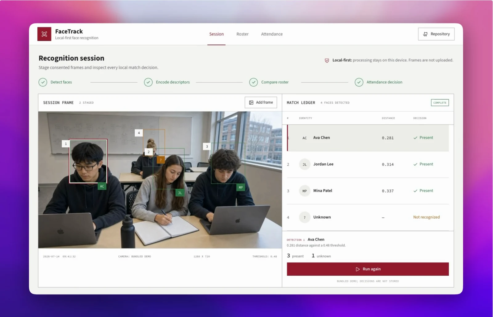

# FaceTrack

[](https://github.com/ethanvillalovoz/facetrack/actions/workflows/ci.yml)
[](LICENSE)
[](https://react.dev/)
[](https://fastapi.tiangolo.com/)

A local-first face-matching reference system for staging consented session frames, inspecting every identity decision, and writing a deduplicated attendance ledger.

[](docs/media/facetrack-demo.mp4)

Select the preview to watch the privacy-safe product fixture move through recognition and into the attendance ledger. Native inference is a separate local-only path because public README media should not silently publish biometric data.

## What It Demonstrates

- A synthetic interactive demo with no accounts, backend, or real face images.
- A real local path built on `face_recognition`, FastAPI, SQLite, and React.
- JPEG/PNG/WebP validation, upload limits, EXIF removal, and image normalization.
- UUID storage names that prevent traversal and accidental overwrite.
- A non-blocking processing lock and structured match summary.
- One attendance record per identity per UTC day, enforced by SQLite.
- Automatic deletion of session frames after processing by default.
- CSV export, roster replacement, responsive UI, tests, lint, and CI.

## Run The Synthetic Demo

The frontend opens in demo mode by default. It uses abstract identities and deterministic decisions while preserving the live API contract.

```bash
git clone https://github.com/ethanvillalovoz/facetrack.git
cd facetrack/frontend
npm install
npm run dev
```

Open `http://localhost:5173`. No image files or credentials are required.

## Run The Local Vision Stack

The native `face_recognition` dependency includes dlib and may require CMake and platform build tools.

```bash
python3 -m venv .venv
source .venv/bin/activate
pip install -r requirements.txt
uvicorn backend.fastapi_app:app --reload
```

In a second terminal:

```bash
cd frontend
cp .env.example .env
npm install
npm run dev
```

`frontend/.env` must include:

```dotenv
VITE_FACETRACK_MODE=live
VITE_API_BASE_URL=http://127.0.0.1:8000
```

## Recognition Pipeline


Face distance is not a calibrated probability. The UI reports the configured threshold and keeps unknown detections unlabelled.

## API Surface

| Method | Route | Purpose |
| --- | --- | --- |
| `GET` | `/health` | Runtime health check |
| `GET` | `/roster/` | List enrolled reference identities |
| `POST` | `/upload/known/` | Validate and enroll one labelled reference |
| `POST` | `/upload/batch/` | Validate and stage one session frame |
| `POST` | `/process/` | Run one locked recognition session |
| `GET` | `/attendance/` | Read the local ledger |
| `GET` | `/attendance/export/` | Export the ledger as CSV |
| `DELETE` | `/attendance/` | Clear the local ledger |

Interactive OpenAPI documentation is available at `http://localhost:8000/docs`.

## Configuration

```dotenv
FACETRACK_ALLOWED_ORIGINS=http://localhost:5173,http://127.0.0.1:5173
FACETRACK_KNOWN_DIR=data/known_faces
FACETRACK_BATCH_DIR=data/batch_images
FACETRACK_DB_PATH=backend/attendance.db
FACETRACK_MAX_UPLOAD_BYTES=8388608
FACETRACK_MAX_IMAGE_PIXELS=25000000
FACETRACK_DELETE_BATCH_AFTER_PROCESS=true
```

## Privacy Boundary

This repository is designed for local, consented experimentation. It deliberately contains no face images. Runtime uploads and databases are ignored by git, reference images are normalized without EXIF metadata, and session frames are deleted after processing unless explicitly configured otherwise.

Do not expose this API to the public internet as-is. A multi-user deployment requires authentication, authorization, encrypted private storage, retention controls, audit logs, rate limits, jurisdiction-specific review, and a documented consent process.

## Verification

```bash
source .venv/bin/activate
ruff check backend src
pytest -q

cd frontend
npm run check
```

The lightweight backend test suite validates upload boundaries, roster replacement, cleanup, processing orchestration, CSV export, and the recognition contract without compiling dlib. Run the full local stack to verify native inference on your target machine.

The maintained native path was also exercised end to end on macOS with the React client, FastAPI, SQLite, dlib, and `face_recognition`: one enrolled reference, one staged frame, one detected face, and one match under the configured `0.48` threshold. This is a runtime check, not an accuracy benchmark.

## Repository Map

```text
backend/
  fastapi_app.py             upload, session, roster, and ledger API
  database/attendance_db.py SQLite constraints and queries
src/
  recognition.py             lazy native recognition pipeline
  cli.py                     one-session command-line runner
frontend/
  src/api/                   deterministic and live API providers
  src/App.jsx                session, roster, and attendance views
docs/media/                  browser-verified interaction capture and poster
data/README.md               local biometric-data policy
```

See [Architecture](docs/architecture.md), [Usage](docs/usage-guide.md), and [Security](SECURITY.md) for operating details.

## License

Released under the [MIT License](LICENSE).
