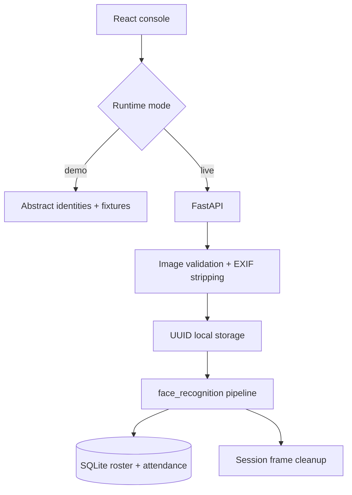

# Architecture

FaceTrack is a local reference implementation with a deterministic review mode and an optional native recognition runtime.

For an evidence-led view of the complete public fixture and its implementation boundaries, see the [FaceTrack decision trace](figures/facetrack-decision-trace/README.md).

## Runtime Modes

The default frontend uses `DemoApiProvider`. It presents synthetic identities and deterministic comparison results through the same methods as the live provider. `VITE_FACETRACK_MODE=live` switches the interface to FastAPI.

## Image Boundary

The API accepts JPEG, PNG, and WebP up to the configured byte limit. Pillow verifies the payload, applies EXIF orientation, converts it to RGB, constrains dimensions, and writes a normalized JPEG. This removes original metadata and avoids trusting the client filename.

## Recognition Boundary

Native dependencies are loaded only when a recognition session runs. Reference files without a detectable face are skipped. A session fails clearly when there are no valid references or no staged frames.

For each detected descriptor:

1. Compute distance to every valid reference descriptor.
2. Select the minimum distance.
3. Match only when the distance is at or below `0.48` by default.
4. Record the identity once per UTC day.
5. Keep above-threshold detections unknown.

The process returns frame count, detected face count, matches, unknown count, newly inserted attendance count, and the threshold used.

## Concurrency And Retention

An in-process lock permits one recognition session at a time. Session frames are deleted in a `finally` block, including failed sessions, unless `FACETRACK_DELETE_BATCH_AFTER_PROCESS=false` is set. Reference images persist until replaced or manually removed.

## Deployment Limits

The API has no user authentication because it is intended for one trusted local operator. Production use requires a private storage and identity architecture rather than a client-side API key bolted onto this prototype.
